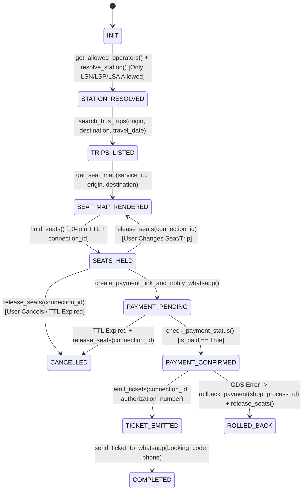

# Autonomous WhatsApp Commerce Closer (`boletos-la-ventas-mcp`)

Production transactional state machine and two-phase commit (2PC) orchestration for closing bus ticket sales autonomously over WhatsApp using the 11-tool `boletos-la-ventas-mcp` MCP server, Bancard vPOS payment gateway, and Delta Bus GDS.

---

## 1. Complete 11-Tool Transactional State Machine

| Phase | FSM State | MCP Tool(s) Invoked | Key Inputs & Invariants | Transition / Compensation Rule |
| :--- | :--- | :--- | :--- | :--- |
| **Phase 1: Discovery & Compliance** | `INIT` -> `STATION_RESOLVED` | `get_allowed_operators`, `resolve_station` | `query` (e.g., `"asuncion"` -> `184`, `"cde"` -> `218`, `"oviedo"` -> `173`, `"encarnacion"` -> `200`) | **STRICT INTEGRATED ALLOWLIST (`01_anti_nsa_policy`)**: Permit **ONLY** actively integrated Delta Bus GDS operators (`LSN`: **La Santaniana**, `LSP`: **La Sampedrana**, `LSA`: **La Santaniana Internacional**). Courteously reject **any** unintegrated carrier (`NSA`, `Sol del Paraguay`, `RYSA`, `Expreso Paraguay`, `Golondrina`, `Canindeyú`, `Crucero del Norte`, etc.) and offer Grupo La Santaniana departures. |
| **Phase 2: Inventory & Visual Seat Map** | `TRIPS_LISTED` -> `SEAT_MAP_RENDERED` | `search_bus_trips`, `get_seat_map` | `origin`, `destination`, `travel_date` (`YYYY-MM-DD`), `service_id` | Format all fares strictly in **Guaraníes (`Gs.`)** (e.g., `Gs. 120.000`). Map Delta states `B` (Bloqueado), `R` (Reservado), and `T` (Tomado) to occupied (`🟥`), rendering 2-floor bus grids (`Piso 1` / `Piso 2`) with `🟩` available and `🟥` occupied. |
| **Phase 3: Atomic Lock & TTL Management** | `SEATS_HELD` (or `SEATS_RELEASED`) | `hold_seats`, `release_seats` | `service_id`, `origin`, `destination`, `seats`, `connection_id` | `hold_seats` locks inventory in GDS for **10 minutes (600s TTL)** and returns `connection_id`. If passenger changes route/seats or cancels before paying, immediately invoke `release_seats(connection_id)`. |
| **Phase 4: Payment Dispatch & Polling** | `PAYMENT_PENDING` -> `PAYMENT_CONFIRMED` | `create_payment_link_and_notify_whatsapp`, `check_payment_status` | `process_id`, `shop_process_id`, `amount` (integer `Gs.` at MCP boundary; backend formats `.2f` `"120000.00"` for Bancard vPOS) | Dispatches Bancard vPOS checkout link (Card/QR) directly to passenger's WhatsApp. Poll `check_payment_status(process_id, shop_process_id, amount)` idempotently until `is_paid == True` and `authorization_number` is returned. |
| **Phase 5: 2PC GDS Emission & Rollback** | `TICKET_EMITTED` -> `COMPLETED` (or `ROLLED_BACK`) | `emit_tickets`, `send_ticket_to_whatsapp`, `rollback_payment` | `authorization_number`, `connection_id`, `company` (`LSN`/`LSP`/`LSA`), `seats_and_passengers` (pure seat tariff + sanitized `docNumber`), `shop_process_id` | Execute `emit_tickets` -> persist to `ticket_events` (`Mi Boleto`) -> `send_ticket_to_whatsapp`. **CRITICAL 2PC INVARIANT**: If `emit_tickets` fails, times out, or throws a GDS exception *after* `is_paid == True`, immediately execute `rollback_payment(shop_process_id)` and `release_seats(connection_id)`. |



---

## 2. Canonical Implementation Patterns

### 2.1. Strict Integrated-Operators-Only Allowlist (`LSN`, `LSP`, `LSA`) & Colloquial Station Resolution

Per `01_anti_nsa_policy` and `boletos-la-ventas-mcp/config.py`, Boletos.la **never** promotes, mocks, or sells unintegrated third-party carriers. Every conversation turn mentioning a bus carrier or terminal must pass through strict positive allowlist normalization (`LSN`, `LSP`, `LSA`) and station alias resolution before querying `search_bus_trips`:

```python
INTEGRATED_OPERATORS = {
    "LSN": "La Santaniana",
    "LSP": "La Sampedrana",
    "LSA": "La Santaniana Internacional",
}

ALLOWED_OPERATORS = tuple(INTEGRATED_OPERATORS.values())

FORBIDDEN_UNINTEGRATED_OPERATORS = (
    "nsa",
    "nuestra señora de la asuncion",
    "nuestra senora de la asuncion",
    "nasa",
    "nasa golondrina",
    "sol del paraguay",
    "expreso paraguay",
    "rysa",
    "golondrina",
    "canindeyu",
    "canindeyú",
    "stel turismo",
    "guaireña",
    "guairena",
    "crucero del norte",
    "yacyreta",
    "yacyretá",
    "cometa del amambay",
    "la ovetense",
    "ciudad de concepcion",
    "crucero del este",
    "beato roque gonzalez",
)

STATION_ALIAS_MAP = {
    "asuncion": "184",
    "asu": "184",
    "terminal de asuncion": "184",
    "cde": "218",
    "ciudad del este": "218",
    "oviedo": "173",
    "coronel oviedo": "173",
    "encarnacion": "200",
    "enc": "200",
}
```

### 2.2. WhatsApp Double-Deck ASCII/Emoji Seat Grid Renderer

WhatsApp collapses consecutive spaces unless formatted inside monospace blocks or structured emoji rows. Always render `get_seat_map` output per deck (`Piso 1` / `Piso 2`) with aisle dividers (`||`), seat numbers padded to 2 digits, quality codes (`SC` Semi Cama, `CA` Cama, `SU` Suite), and Guaraníes (`Gs.`) pricing:

```python
def render_whatsapp_seat_grid(seat_map_payload: dict) -> str:
    """
    Renders a mobile-friendly WhatsApp seat map from get_seat_map output.
    Legend: [01🟩] Available | [02🟥] Occupied | || Aisle
    """
    lines = [
        f"🚌 *Mapa de Asientos — Servicio #{seat_map_payload['service_id']}*",
        "🟩 Disponible | 🟥 Ocupado",
        "",
    ]
    for floor in seat_map_payload.get("floors", []):
        lines.append(f"*--- PISO {floor['floor_number']} ({floor['quality_label']} - Gs. {floor['price_gs']:,}".replace(",", ".") + ") ---*")
        row_Seats = floor.get("seats", [])
        for i in range(0, len(row_Seats), 4):
            chunk = row_Seats[i : i + 4]
            left = " ".join(
                f"[{int(s['number']):02d}{'🟩' if s['status'] == 'available' else '🟥'}]"
                for s in chunk[:2]
            )
            right = " ".join(
                f"[{int(s['number']):02d}{'🟩' if s['status'] == 'available' else '🟥'}]"
                for s in chunk[2:4]
            )
            lines.append(f"`{left}  ||  {right}`" if right else f"`{left}`")
        lines.append("")
    return "\n".join(lines).strip()
```

### 2.3. Two-Phase Ticket Emission & Automatic `rollback_payment` Compensation

Never leave a passenger with a captured Bancard charge (`is_paid: True`) and an unissued GDS ticket. Wrap `emit_tickets` in a strict compensating transaction block:

```python
def finalize_paid_booking(mcp_client, session) -> dict:
    """
    Executes Phase 5 (2PC):
    1. Verifies check_payment_status -> is_paid == True & authorization_number present.
    2. Calls emit_tickets with exact seats_and_passengers schema.
    3. On any GDS failure, triggers rollback_payment(shop_process_id) + release_seats(connection_id).
    4. On success, dispatches boarding QR via send_ticket_to_whatsapp.
    """
    payment = mcp_client.check_payment_status(
        process_id=session.process_id,
        shop_process_id=session.shop_process_id,
        amount=session.total_amount_gs,
    )
    if not payment.get("is_paid") or not payment.get("authorization_number"):
        return {"status": "PAYMENT_PENDING", "shop_process_id": session.shop_process_id}

    try:
        emission = mcp_client.emit_tickets(
            service_id=session.service_id,
            origin=session.origin_id,
            destination=session.destination_id,
            company=session.company,
            connection_id=session.connection_id,
            authorization_number=payment["authorization_number"],
            seats_and_passengers=session.seats_and_passengers,
            total_amount=session.total_amount_gs,
        )
        if not emission or emission.get("error") or not emission.get("booking_code"):
            raise RuntimeError(emission.get("error", "GDS emission returned empty booking_code"))
    except Exception as exc:
        rollback = mcp_client.rollback_payment(shop_process_id=session.shop_process_id)
        mcp_client.release_seats(connection_id=session.connection_id)
        return {
            "status": "ROLLED_BACK",
            "reason": str(exc),
            "rollback_confirmed": bool(rollback.get("rolled_back", True)),
            "shop_process_id": session.shop_process_id,
        }

    mcp_client.send_ticket_to_whatsapp(
        phone=session.phone,
        passenger_name=session.primary_passenger_name,
        origin=session.origin_name,
        destination=session.destination_name,
        company=session.company,
        departure_date=session.travel_date,
        departure_time=session.departure_time,
        seat_numbers=",".join(p["seat"] for p in session.seats_and_passengers),
        booking_code=emission["booking_code"],
        ticket_numbers=emission.get("ticket_numbers"),
        total_amount=session.total_amount_gs,
    )
    return {"status": "COMPLETED", "booking_code": emission["booking_code"]}
```

---

## 3. Progressive Disclosure & Domain Resources

1. **System Configuration & Guardrails**: Inspect **[resources/config-template.json](./resources/config-template.json)** for the 11 MCP tool contracts, 600-second seat hold TTL settings, allowed operators list, station aliases, and Bancard vPOS retry intervals.
2. **Architecture & Compensation Manual**: Consult **[references/architecture-and-patterns.md](./references/architecture-and-patterns.md)** for full MCP payload schemas, Paraguayan Cédula (`CI`) and Chilean `RUT` Mod-11 validation algorithms, and multi-passenger seat assignment rules.
3. **Executable 2PC State Machine & Seat Renderer**: Run **[examples/reference_implementation.py](./examples/reference_implementation.py)** to execute the deterministic `WhatsAppCommerceStateMachine`, visual seat grid renderer, passenger document validators, and automatic `rollback_payment` test suite:

```powershell
python ./examples/reference_implementation.py
```

4. **Domain Contract & Test Suite Validator**: Run **[scripts/validate_skill_domain.py](./scripts/validate_skill_domain.py)** to verify directory integrity, YAML frontmatter rules, relative links, config schema completeness, and all 9+ edge-case unit tests:

```powershell
python ./scripts/validate_skill_domain.py
```

---

# Core Implementation & Verification Checklist

| Requirement | Verification Criterion | Mandatory Tool / Guardrail |
| :--- | :--- | :--- |
| **Strict Integrated-Only Allowlist** | Only integrated Delta GDS operators (`LSN` **La Santaniana**, `LSP` **La Sampedrana**, `LSA` **La Santaniana Internacional**) are permitted; all unintegrated carriers (`NSA`, `Sol del Paraguay`, `RYSA`, etc.) are blocked immediately | `get_allowed_operators`, `search_bus_trips`, `normalize_operator_code()` |
| **Colloquial Station Resolution** | Slang/aliases (`"cde"`, `"asu"`, `"oviedo"`, `"encarnacion"`) resolve to canonical GDS IDs (`218`, `184`, `173`, `200`) | `resolve_station` |
| **Guaraníes (`Gs.`) & Pure Seat Tariff** | Fares formatted as `Gs. XXX.XXX`; `emit_tickets` receives pure Delta seat tariff (no 5% fee markup -> avoids `CodigoError: 233`) and 3-letter operator code (`LSN`/`LSP`/`LSA`) | `format_guaranies()`, `normalize_operator_code()` |
| **Visual Seat Map Rendering** | Delta states `B`/`R`/`T` map to occupied (`🟥`); multi-floor layouts render with `🟩`/`🟥` and aisle separators (`\|\|`) | `get_seat_map` + `render_whatsapp_seat_grid()` |
| **Atomic 10-Min Seat Hold** | Holding seats stores `connection_id` and starts a 600-second TTL timer; modifications call `release_seats` first | `hold_seats`, `release_seats` |
| **Sanitized Passenger Document** | Strip dots/hyphens/spaces (`CodigoError: 335` prevention) and validate Paraguayan `CI` (5–8 digits) or Chilean `RUT` (Mod-11) before holding/paying | `validate_passenger_document()` |
| **2PC Payment & GDS Rollback** | If `emit_tickets` fails after `check_payment_status` returns `is_paid: True`, `rollback_payment` and `release_seats` run automatically | `check_payment_status`, `emit_tickets`, `rollback_payment`, `send_ticket_to_whatsapp` |
