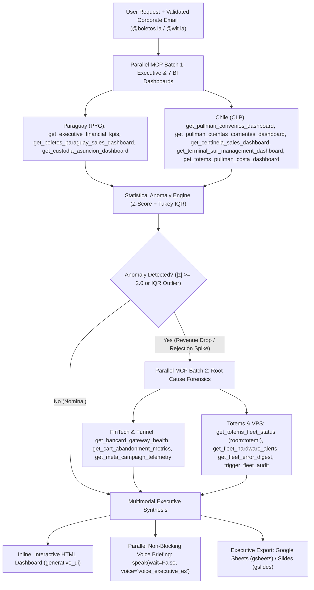

# Boletos.la & Grupo Pullman — Executive BI Anomaly Narrator (`boletos-monitoreo`)

Production C-level Business Intelligence, statistical anomaly detection (`Z-score` + `Tukey IQR`), FinTech gateway SLA correlation (**Bancard vPOS** & **Transbank**), self-service kiosk telemetry (`room:totem:<id>`), and multimodal executive reporting (`generative_ui` `<agent-embed>`, Google Sheets/Slides export, and non-blocking Chilean executive voice synthesis) across **Paraguay (`PYG`)** and **Chile (`CLP`)**.

---

## 1. Mandatory Governance & Access Guardrails (`instructions.md`)

Before invoking any tool in the `boletos-monitoreo` MCP server, enforce these four non-negotiable policies:

1. **Corporate Identity Gatekeeper (`user_email`)**:
   - Every tool requires a valid corporate email ending in `@boletos.la` or `@wit.la`.
   - If the user has not provided their corporate email in the session, prompt for it before executing any MCP query.
2. **100% Read-Only Execution**:
   - `boletos-monitoreo` is strictly read-only observability. Never attempt to mutate production databases or issue tickets from BI audit workflows.
3. **Inviolable Zero-NSA Rule (`Nuestra Señora de la Asunción`)**:
   - **NEVER** display, associate, attribute, or mock data for **NSA** (`Nuestra Señora de la Asunción`).
   - Only audit authorized Paraguayan interurban operators (`LSN` — La Santaniana, `LSP` — La Sanlorenzana, `LSA` — Lago Ypoá).
4. **Integer Currency Integrity (`PYG` vs `CLP`)**:
   - Format Paraguayan Guaraníes (`PYG`) strictly as integer `Gs. 150.000` (dot thousands separator, **zero decimals** in BI tables/charts). Strip `.00` wire strings returned by Bancard vPOS before aggregating, and reject any non-zero fractional cents (`CurrencyCorruptionError`).
   - Format Chilean Pesos (`CLP`) strictly as integer `$1.203.450 CLP`.

---

## 2. Parallel Multi-Country BI & SRE Audit Architecture



---

## 3. Master Matrix of the 7 Executive BI Platforms & Anomaly Thresholds

| Platform ID | MCP Tool (`boletos-monitoreo`) | Country / Currency | Core KPIs & Fee Structure | Critical Anomaly Trigger |
| :--- | :--- | :--- | :--- | :--- |
| **`boletos_paraguay`** | `get_boletos_paraguay_sales_dashboard` | Paraguay (`PYG`) | Interurban sales (`Web 75%`, `Totem 23.5%`), operators `LSN`, `LSP`, `LSA` (Zero `NSA`) | Daily revenue `z <= -2.5` or Web share `< 60%` |
| **`custodia_asuncion`** | `get_custodia_asuncion_dashboard` | Paraguay (`PYG`) | Smart lockers (`S`, `M`, `L`, `XL`), `Efectivo` vs `Tarjeta` Bancard vPOS | Card payment share drop `> 20%` (`vPOS` outage) |
| **`pullman_convenios`** | `get_pullman_convenios_dashboard` | Chile (`CLP`) | `convenios.vista_reporte_eventos` RDS: B2B agreements, top destinations, annulment rate | Annulment rate `> 6.0%` or daily volume `z <= -2.5` |
| **`pullman_cuentas_corrientes`** | `get_pullman_cuentas_corrientes_dashboard` | Chile (`CLP`) | `multiempresa_db` RDS: 154 corporate accounts (`Sodexo`, `Aramark`), credit balance | Refund opportunity cost spike `z >= 2.5` |
| **`centinela`** | `get_centinela_sales_dashboard` | Chile (`CLP`) | Mining transport (`Ovalle-Centinela`), target effectiveness `97.5%`, refunds `2.5%` | Fleet effectiveness `< 95.0%` or refunds `> 5.0%` |
| **`terminal_sur`** | `get_terminal_sur_management_dashboard` | Chile (`CLP`) | Cajas Baños (`$557M`), Tótems Baños (`$44M`), Custodia Equipaje (`$45M`) | Turnstile or locker DB sync lag `> 15 min` |
| **`totems_pullman_costa`** | `get_totems_pullman_costa_dashboard` | Chile (`CLP`) | 12 self-service totems (`Alameda` & `Viña`), `1.0%` Transbank fee, `2.5%` WIT fee | Offline kiosk `room:totem:<id>` or POS serial `NAK` |

---

## 4. Canonical Implementation Patterns

### 4.1. Parallel C-Level Audit & Root-Cause Correlation Protocol

When the user requests an executive audit or asks why sales dropped:

1. **Batch 1 (Executive Snapshot & BI Catalog)**:
   - Call `get_executive_bi_catalog(user_email=..., formato="json")`, `get_executive_financial_kpis(user_email=..., period="last_7_days")`, `get_bancard_gateway_health(user_email=...)`, and `get_cart_abandonment_metrics(user_email=...)` in parallel.
2. **Batch 2 (Platform Drill-Down & Hardware Correlation)**:
   - Run `detect_kpi_anomaly()` from [`examples/reference_implementation.py`](./examples/reference_implementation.py) over the daily revenue series.
   - If Bancard approval rate is `< 85.0%` or totem channel sales dropped (`z <= -2.0`), immediately invoke `get_totems_fleet_status(user_email=..., country="all")`, `get_fleet_hardware_alerts(user_email=...)`, and `get_fleet_error_digest(user_email=...)`.
   - If any AWS Lightsail microservice (`gds`, `bancard`, `pdf`, `convenios`, `n8n`, `vpn`, `publicidad`, `analitica`, `itinerarios`) exhibits `RAM > 85%` or `Disk > 90%`, inspect `get_service_logs(user_email=..., service_id=..., log_type="error")` and execute `trigger_fleet_audit(user_email=...)`.

### 4.2. Deterministic Anomaly, Currency & Voice Synthesizer (Python)

```python
from examples.reference_implementation import (
    validate_corporate_email,
    format_executive_currency,
    detect_kpi_anomaly,
    evaluate_bancard_gateway_sla,
    evaluate_totem_and_server_fleet,
    build_chilean_executive_voice_briefing,
    render_agent_embed_kpi_dashboard,
)

email = validate_corporate_email("gerencia@boletos.la")
anom = detect_kpi_anomaly(
    metric_name="Recaudación Diaria PYG",
    platform_id="boletos_paraguay",
    historical_series=[45000000, 46200000, 45800000, 47100000, 46000000],
    current_value=30500000,
    currency="PYG",
)
# Formats cleanly as 'Gs. 30.500.000' (zero decimal corruption)
assert anom.formatted_current == "Gs. 30.500.000" and anom.severity == "CRITICAL"
```

### 4.3. Multimodal Delivery: `<agent-embed>`, Google Workspace & Non-Blocking TTS

1. **Interactive `<agent-embed>` Dashboard (`generative_ui`)**:
   - Emit the self-contained `<agent-embed>` widget generated by `render_agent_embed_kpi_dashboard()` so the executive can inspect `PYG`/`CLP` scorecards, `Z-score` badges, Bancard SLA, and `room:totem:<id>` status inline.
2. **Google Sheets / Slides Executive Export (`gsheets` / `gslides`)**:
   - When the user requests a boardroom deck or spreadsheet export, synchronize the sanitized KPI table to Google Sheets (`gsheets` skill) or executive summary slides (`gslides` plugin), preserving exact integer `Gs.` and `$ CLP` formatting.
3. **Fire-and-Forget Chilean Executive Voice Briefing (`speak`)**:
   - Always invoke `speak` from the `gemini-tts` MCP server in parallel with `wait: False`, `voice: "voice_executive_es"`, `speed: 1.15`, `lang: "es"`, and at most 2 concise sentences:
   ```json
   {
     "text": "Te informo al tiro que detectamos una anomalía crítica en boletos_paraguay con Gs. 30.500.000 y un desvío Z de -23.6. La pasarela Bancard registra 75.0% de aprobación con 1 tótem desconectado en Asunción.",
     "voice": "voice_executive_es",
     "speed": 1.15,
     "lang": "es",
     "wait": false
   }
   ```

---

## 5. Progressive Disclosure Navigation

- **[references/architecture-and-patterns.md](./references/architecture-and-patterns.md)**: Complete 31+1 tool taxonomy for `boletos-monitoreo`, parametric Z-score + non-parametric IQR formulas, currency integrity rules, and `room:totem:<id>` correlation.
- **[resources/config-template.json](./resources/config-template.json)**: Canonical thresholds, currency rules (`PYG`/`CLP`), 7 BI platforms metadata, and all `boletos-monitoreo` tool identifiers.
- **[examples/reference_implementation.py](./examples/reference_implementation.py)**: Deterministic KPI anomaly detector, PYG/CLP formatter, Bancard SLA evaluator, totem hardware correlator, and `<agent-embed>` + TTS synthesizer.
- **[scripts/validate_skill_domain.py](./scripts/validate_skill_domain.py)**: 10-case deterministic validation suite (`sys.dont_write_bytecode = True`).

---

# Core Implementation & Verification Checklist

Run the standalone lightweight Python engine (`python`) to verify all domain guardrails and unit tests:

```powershell
# 1. Execute the 10-case deterministic domain & statistical validator (exits 0)
python ./scripts/validate_skill_domain.py

# 2. Run the end-to-end C-level BI anomaly & multimodal briefing simulation
python ./examples/reference_implementation.py
```

| Verification Gate | Requirement | Enforcement |
| :--- | :--- | :--- |
| **Corporate Email Gate** | Reject any call lacking `@boletos.la` or `@wit.la` | `validate_corporate_email()` raises `UnauthorizedCorporateEmailError` |
| **Zero-NSA Firewall** | Block any input/output containing `NSA` or `Nuestra Señora de la Asunción` | `assert_no_nsa_exposure()` raises `ForbiddenOperatorExposureError` |
| **Guaraní Integer Integrity** | Format `PYG` as `Gs. 150.000` with zero decimal corruption | `format_executive_currency()` raises `CurrencyCorruptionError` on fractional cents |
| **Non-Blocking Voice TTS** | `speak` call must set `wait: false`, `voice: "voice_executive_es"`, `<= 2` sentences | Verified by Case 10 in `scripts/validate_skill_domain.py` |
