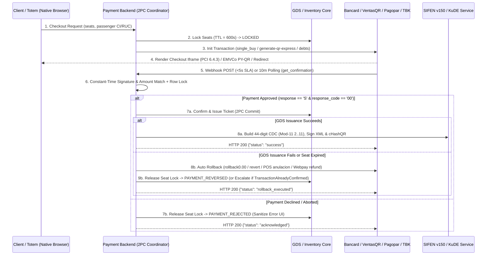

# LATAM FinTech Gateways (Paraguay & Chile) & DNIT SIFEN v150 Invoicing

Production engineering guide, verified cryptographic contract specification, and 2-Phase Commit (2PC) compensation architecture for Paraguayan and Chilean payment gateways (**Bancard vPOS v1.23.1**, **Bancard VentasQR**, **Bancard Caja POS Android 2.0 `ICP v1.7`**, **Infonet Cobranzas**, **Pagopar 2.0/1.1/3.0 + uPay**, **Dinelco / Bepsa**, **AdamsPay v1**, **Tigo Money MFS v2**, **BCP SIPAP / SPI / PY-QR**, **Transbank Webpay Plus / Serial POS**) and Paraguayan Electronic Invoicing (**DNIT SIFEN / Ekuatia v150**).

---

## 1. Core Architecture & Verified Gateway Matrix

| System / Operation | Cryptographic / Auth Contract | Official Endpoint / Standard | Mandatory Production Guardrail |
| :--- | :--- | :--- | :--- |
| **Bancard vPOS `single_buy`** | `md5(priv + shop_process_id + amount + currency)` (`amount` = `"150000.00"`) | `POST /vpos/api/0.3/single_buy`<br>SDK: `bancard-checkout-4.0.0.js` (`>=320px`) | Enforce `.00` decimal string even for integer `PYG`; consolidate `billing.details` with `total_items: 1` when passing order total. |
| **Bancard vPOS Tokenization (`cards/new`, `users`, `charge`, `delete`)** | `cards/new`: `md5(priv + card_id + user_id + "request_new_card")`<br>`list`: `md5(priv + user_id + "request_user_cards")`<br>`charge`: `md5(priv + id + "charge" + amt + curr + alias)`<br>`delete`: `md5(priv + "delete_card" + user_id + alias)` | `POST /vpos/api/0.3/cards/new`<br>`POST` & `DELETE /vpos/api/0.3/users/{id}/cards`<br>`POST /vpos/api/0.3/charge` | Max **5 cards** per `user_id`; `alias_token` expires in **15 min** (never store long-term); pass `"extra_response_attributes": ["confirmation.process_id"]` on `charge` for `Charge3DS`; **Mastercard MAC 03/21**: 7/24h or 35/30d declines block card 30 days. |
| **Bancard vPOS Webhook, Polling & 2PC Rollback** | `confirm`: `md5(priv + id + "confirm" + amt + curr)`<br>`poll`: `md5(priv + id + "get_confirmation")`<br>`rollback`: `md5(priv + id + "rollback" + "0.00")` | Incoming `POST` (30s timeout, `<5s` SLA)<br>`POST /vpos/api/0.3/single_buy/confirmations`<br>`POST /vpos/api/0.3/single_buy/rollback` | Approve strictly on `response === "S" && response_code === "00"` (`timingSafeEqual`); rollback token omits `currency` (if couponed -> `"TransactionAlreadyConfirmed"`, escalate to manual portal annulment); **never** render `authorization_number`, `response_code`, `extended_response_description`, or `security_information` on UI. |
| **Bancard Preauth & Electronic Billing** | `preauth`: `md5(priv + id + "pre-authorization-confirm")`<br>`client_info`: `md5(priv + "billing_client_info")`<br>`billing_cancel`: `md5(priv + id + "billing_cancel")` | `POST /vpos/api/0.3/preauthorizations/confirm`<br>`POST /vpos/api/0.3/billing/client_info`<br>`POST /vpos/api/0.3/billing/cancel` | Preauth MD5 has **no** amount/currency; **1 single attempt**, 30d expiry, `> USD 1` (Credit: hold `<= 120%`, 1 boleta; Debit: immediate debit `<= 100%`, 2 boletas; cancel via `single_buy/rollback`). `billing/*` are electronic invoice ops (`cancel` `< 24h`). |
| **Bancard VentasQR (Standalone Commerce QR)** | HTTP Basic Auth: `apps/{public_key}:{private_key}` (Base64) + `iva-sale` | `POST /commerces/{code}/branches/{branch}/selling/generate-qr-express`<br>`PUT .../selling/payments/revert/{hook_alias}` | Do **not** call non-existent `/vpos/api/0.3/qr/generate`; use VentasQR Express (integer `PYG`) or vPOS Checkout `GET /checkout/generate_qr?process_id={id}`. |
| **Bancard Caja POS Android 2.0 (`ICP v1.7`)** | LAN REST JSON (`POST`-only, `facturaNro` `0..999999999999999` `int(15)`, `nroBoleta` 12 digits) | `POST http://<IP_POS>:3000/pos/*` (`eco`, `venta-ux`, `venta/debito`, `venta/credito`, `descuento`, `venta-qr`, `venta-qr-pix`, `venta-billetera`, `consulta/anulacion`, `anulacion`) | `venta-ux` is **2-step** (`monto` `int(9)`, `cuotas: 0`/omitted or `>1` with `plan: 1`, never `1`) $\to$ `POST /pos/descuento` (`{bin, nsu, monto}`); `venta-billetera` uses `{"facturaNro", "monto", "billetera", "cuenta"}` (`ZIM/WPJ/VBV/BPI/BBF`). |
| **Infonet Cobranzas (Billers)** | Biller Basic/Token Auth + idempotent `tid` | `consulta` $\to$ `pago` $\to$ `reversa` | Validate subscriber/booking debt on `consulta`; support atomic same-day `reversa` by `tid`. |
| **Pagopar 2.0 / 1.1 / 3.0 (`Bancard` & `uPay`)** | Init: `sha1(priv + id_pedido + monto_int_str)`<br>Webhook: `sha1(priv + hash_pedido)`<br>Action: `sha1(priv + LITERAL)` | `POST /api/comercios/2.0/iniciar-transaccion`<br>`POST /api/forma-pago/1.1/traer`<br>`POST /api/pedidos/1.1/traer` & `reversar`<br>`POST /api/pago-recurrente/3.0/*` | Serialize whole `PYG` without `.0` (`"150000"`); literals: `"FORMA-PAGO"`, `"CONSULTA"`, `"PEDIDO-REVERSAR"`, `"PAGO-RECURRENTE"` (`proveedor: "Bancard" \| "uPay"`). |
| **AdamsPay v1, Tigo Money MFS v2 & Dinelco/Bepsa** | AdamsPay: Header `apikey` + Webhook `x-adams-notify-hash = md5("adams" + rawBody + secret)`<br>Tigo MFS v2: OAuth2 Bearer | `POST https://api.adamspay.com/api/v1/debts`<br>`POST /v2/tigo/mfs/payments/authorizations`<br>Dinelco Checkout / Link / PY-QR | Preserve raw HTTP body bytes before JSON parsing for AdamsPay MD5 webhook verification; handle async USSD push timeouts on Tigo Money. |
| **BCP SIPAP / SPI / PY-QR (EMVCo)** | **Ley 7503/2025**; CRC-16/CCITT-FALSE (`poly=0x1021`, `init=0xFFFF`) | SPI 24/7 (`<= Gs. 10.000.000` instant cap), Currency ISO 4217 `600` (`PYG`), MCC `4131` (Bus Lines) | Compute 4-hex uppercase CRC over entire EMVCo string ending with `6304`; enforce integer `PYG` tag `54`. |
| **DNIT SIFEN v150 & KuDE Tax QR** | 44-digit CDC (`Mod-11` weights **`2..11`**) + X.509 `.p12` RSA-SHA256 `XMLDSig` + mTLS (6 WSDLs) + `cHashQR = sha256(params + CSC)` | `https://sifen.set.gov.py/de/ws/*`<br>`https://ekuatia.set.gov.py/consultas/qr?` | **Ley 6380/2019 Art. 100 Num. 3 Inc. h**: transport is **Exento (`0%`, `iAfecIVA=3` in `<dSubExe>`) `<= 100 km`** & international, **10% `> 100 km`** — **never 5%**; enforce `DE_v150.xsd` `<gDatRec>` `iNatRec=1` (RUC) vs `iNatRec=2` (`iTipIDRec`/`dNumIDRec` without RUC tags). |
| **Transbank Webpay Plus & Serial POS** | Headers: `Tbk-Api-Key-Id`, `Tbk-Api-Key-Secret`; Serial `STX + Payload + ETX + LRC` | `POST`/`PUT`/`GET /rswebpaytransaction/api/webpay/v1.2/transactions/{token}` | Catch HTTP `422` on duplicate `PUT` commit and fall back to `GET` status; handle `TBK_TOKEN` user abort. |

---

## 2. Two-Phase Commit (2PC) Payment & Ticketing State Machine



---

## 3. Canonical Implementation Patterns

### 3.1. Complete Bancard vPOS v1.23.1 (All 11 Official Operations), VentasQR & AdamsPay Helpers (TypeScript)

```typescript
import crypto from 'node:crypto';

export function formatBancardAmount(amount: number): string {
  if (!Number.isFinite(amount) || amount <= 0) {
    throw new Error(`Invalid transaction amount: ${amount}`);
  }
  return amount.toFixed(2); // Mandatory "150000.00" format even for integer PYG
}

const md5Hex = (raw: string): string => crypto.createHash('md5').update(raw, 'utf8').digest('hex');

export const BancardVposTokens = {
  singleBuy: (priv: string, id: string | number, amt: number, curr: 'PYG' | 'USD' = 'PYG') =>
    md5Hex(`${priv}${id}${formatBancardAmount(amt)}${curr}`),
  cardsNew: (priv: string, cardId: string | number, userId: string | number) =>
    md5Hex(`${priv}${cardId}${userId}request_new_card`),
  listUserCards: (priv: string, userId: string | number) =>
    md5Hex(`${priv}${userId}request_user_cards`),
  chargeAlias: (priv: string, id: string | number, amt: number, curr: 'PYG' | 'USD', aliasToken: string) =>
    md5Hex(`${priv}${id}charge${formatBancardAmount(amt)}${curr}${aliasToken}`),
  deleteCard: (priv: string, userId: string | number, aliasToken: string) =>
    md5Hex(`${priv}delete_card${userId}${aliasToken}`),
  webhookConfirm: (priv: string, id: string | number, amtFormatted: string, curr: 'PYG' | 'USD' = 'PYG') =>
    md5Hex(`${priv}${id}confirm${amtFormatted}${curr}`),
  getConfirmation: (priv: string, id: string | number) =>
    md5Hex(`${priv}${id}get_confirmation`),
  rollbackPreBatch: (priv: string, id: string | number) =>
    md5Hex(`${priv}${id}rollback0.00`), // Strictly literal "0.00" with NO currency
  preauthConfirm: (priv: string, id: string | number) =>
    md5Hex(`${priv}${id}pre-authorization-confirm`), // Strictly NO amount or currency in MD5
  billingClientInfo: (priv: string) =>
    md5Hex(`${priv}billing_client_info`),
  billingCancel: (priv: string, id: string | number) =>
    md5Hex(`${priv}${id}billing_cancel`),
};

export function buildBancardVentasQrBasicAuth(publicKey: string, privateKey: string): string {
  // Official VentasQR Commerce Header for /commerces/{code}/branches/{branch}/selling/generate-qr-express
  const credentials = Buffer.from(`apps/${publicKey}:${privateKey}`, 'utf8').toString('base64');
  return `Basic ${credentials}`;
}

export function verifyAdamsPayWebhook(rawBody: string, secret: string, receivedHash: string): boolean {
  if (!/^[a-f0-9]{32}$/i.test(receivedHash)) return false;
  const expected = md5Hex(`adams${rawBody}${secret}`);
  return crypto.timingSafeEqual(Buffer.from(expected, 'utf8'), Buffer.from(receivedHash.toLowerCase(), 'utf8'));
}
```

### 3.2. BCP PY-QR EMVCo CRC-16/CCITT-FALSE (`0x1021`) & DNIT SIFEN Mod-11 (`2..11`)

```typescript
export function computeEmvcoCrc16CcittFalse(payloadThrough6304: string): string {
  // ISO/IEC 13239 CRC-16/CCITT-FALSE: poly=0x1021, init=0xFFFF, xorOut=0x0000
  let crc = 0xffff;
  const bytes = Buffer.from(payloadThrough6304, 'utf8');
  for (const b of bytes) {
    crc ^= b << 8;
    for (let bit = 0; bit < 8; bit++) {
      crc = (crc & 0x8000) !== 0 ? ((crc << 1) ^ 0x1021) & 0xffff : (crc << 1) & 0xffff;
    }
  }
  return crc.toString(16).toUpperCase().padStart(4, '0');
}

export function calculateSifenMod11(numericChain: string, maxWeight = 11): number {
  // DNIT Paraguay SIFEN v150 Modulo 11: weights cycle 2..11 right-to-left (never 2..9)
  if (!/^\d+$/.test(numericChain)) {
    throw new Error('Input for DNIT Mod-11 must contain only digits');
  }
  let weight = 2;
  let total = 0;
  for (let i = numericChain.length - 1; i >= 0; i--) {
    total += Number(numericChain[i]) * weight;
    weight = weight >= maxWeight ? 2 : weight + 1;
  }
  const remainder = total % 11;
  return remainder <= 1 ? 0 : 11 - remainder;
}

export function resolveParaguayTransportIvaRate(distanceKm: number, isInternational = false): 0 | 10 {
  // Ley 6380/2019 Art. 100 Num. 3 Inc. h: <= 100 km or international = Exento (0%); > 100 km = 10% (NEVER 5%)
  if (isInternational || distanceKm <= 100) return 0;
  return 10;
}
```

---

## 4. Progressive Disclosure Navigation

Load these domain files only as needed for your specific task:

- **Architecture & Complete Paraguayan/Chilean Gateway Specifications**:
  - **[references/architecture-and-patterns.md](./references/architecture-and-patterns.md)**: Full endpoint, payload, and token catalog for Bancard vPOS v1.23.1 (all 11 official operations), Bancard VentasQR, Bancard Caja POS Android 2.0 (`ICP v1.7`), Infonet Cobranzas, Pagopar 2.0/1.1/3.0 (`uPay`), Dinelco/Bepsa, AdamsPay v1, Tigo Money MFS v2, BCP SIPAP/SPI/PY-QR (Ley 7503/2025), and Transbank.
  - **[references/sifen-ekuatia-v150-xml-and-kude.md](./references/sifen-ekuatia-v150-xml-and-kude.md)**: SIFEN v150 6 mTLS WSDLs, Ley 6380/2019 passenger transport IVA (`<=100 km` Exento `<dSubExe>` vs `>100 km` 10% `<dSub10>`), `DE_v150.xsd` `<gDatRec>` exclusivity, X.509 `.p12` `XMLDSig`, real `DigestValue` `cHashQR`, and DNIT codes (`0260` Approved vs `0142` Cert Invalid).
  - **[references/bancard-pagopar-transbank-webhooks.md](./references/bancard-pagopar-transbank-webhooks.md)**: Idempotency locking, 30s/5s webhook SLAs, 10-minute polling, 2PC rollback vs `TransactionAlreadyConfirmed` manual escalation & `billing/cancel`, PCI DSS v4.0.1 Req. 6.4.3/11.6.1, and Webpay HTTP 422 idempotency.
- **Templates & Schemas**:
  - **[resources/config-template.json](./resources/config-template.json)**: Verified configuration schema for all Paraguayan gateways, Caja POS Android v1.7 (17 `IssuerId`s & 5 wallets), EMVCo PY-QR, SIFEN DNIT v150, and Transbank.
  - **[resources/sifen-de-v150-template.xml](./resources/sifen-de-v150-template.xml)**: Canonical SIFEN v150 `rDE` XML template with `gTimb`, `gDatGralOpe` (`iNatRec=1` vs `iNatRec=2`), `gCamItem`, `gTotSub`, `Signature`, and `gCamFuFD`.
- **Executable Reference Implementations**:
  - **[examples/reference_implementation.py](./examples/reference_implementation.py)**: Complete runnable Python harness testing all 11 Bancard v1.23.1 tokens, VentasQR Basic Auth, Caja POS Android v1.7 validation (`int(15)` `facturaNro`), Pagopar 2.0/1.1/3.0, AdamsPay MD5, EMVCo PY-QR CRC-16 `0x1021`, SIFEN 44-digit CDC + X.509 RSA-SHA256 XMLDSig + KuDE PDF, and Transbank.
  - **[examples/typescript_gateway_orchestrator.ts](./examples/typescript_gateway_orchestrator.ts)**: Cross-language TypeScript orchestrator verified for vector parity against Python via Node.js.

---

## 5. Execution & Validation Protocol

Always verify domain integrity and cryptographic test vectors using the standalone Python engine:

```powershell
# 1. Run deterministic static, cryptographic & cross-language TS/PY validator
python ./scripts/validate_skill_domain.py

# 2. Run end-to-end payment, PY-QR, POS Android, 2PC rollback & SIFEN invoicing harness
python ./examples/reference_implementation.py
```

---

## 6. Anti-Patterns & Production Guardrails

- **Never call non-existent `/vpos/api/0.3/qr/generate`, `/vpos/api/0.3/preauthorizations/abort`, or `/vpos/api/0.3/single_buy/charge_back`**: None of these exist in the official Bancard vPOS v1.23.1 REST API. Use **Bancard VentasQR** (`generate-qr-express`), cancel preauthorizations via `/vpos/api/0.3/single_buy/rollback`, and handle `"TransactionAlreadyConfirmed"` via manual commercial annulment in `comercios.bancard.com.py`.
- **Never format Bancard PYG amounts without `.00`, append currency to `rollback`, or include amount/currency in `preauthorizations/confirm` MD5**: `single_buy` requires `"150000.00"`, `single_buy/rollback` hashes `priv + id + "rollback" + "0.00"`, and `preauthorizations/confirm` hashes `priv + id + "pre-authorization-confirm"`.
- **Never use HTTP `GET`, cap `facturaNro` at 7 digits, or pass `cuotas: 1` to Bancard Caja POS Android**: `ICP v1.7` mandates `POST` on all `:3000/pos/*` endpoints, `facturaNro` up to 15 digits (`int(15)`), `cuotas: 0`/omitted for Contado or `cuotas > 1` with `plan: 1` for installments, and `"billetera"` (not `"idBilletera"`/`"codBilletera"`) on `/pos/venta-billetera`.
- **Never tax Paraguayan bus tickets at `5%` IVA, emit `<dRucRec>` when `iNatRec=2`, or use Mod-11 weights `2..9`**: Under **Ley 6380/2019 Art. 100 Num. 3 Inc. h**, passenger transport is **Exento (`0%`, `<dSubExe>`) up to `100 km`** (and international) and **10% over `100 km`**. Non-taxpayers (`iNatRec=2`) must emit `<iTipIDRec>`/`<dNumIDRec>` without `<dRucRec>`/`<dDVRec>`. DNIT Modulo 11 cycles weights **`2..11`**.
- **Never render `authorization_number`, `response_code`, `extended_response_description`, or `security_information` on public payment screens**: Bancard v1.23.1 certification strictly prohibits exposing these fields to end users on both approved and rejected response screens.
